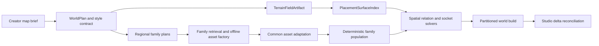

# Basalt architecture

This document describes the dedicated hierarchical world compiler. Product
principles live in [BASALT.md](BASALT.md), visual direction in
[VISUALS.md](VISUALS.md), evidence policy in [EVALS.md](EVALS.md), and planned
work in [ROADMAP.md](ROADMAP.md).

## System boundary

Basalt accepts a map brief, references, style direction, and optional external
gameplay anchors. It returns an immutable, partitioned world build and a
canonical Studio connector transaction plan.

Gameplay generation, gameplay ASTs, runtime modules, and mechanic-specific
scripts are outside this boundary. An external game project may consume the
world build's anchors, routes, sockets, and named bindings.

## Authorities

| Concern                                    | Authority                                               |
| ------------------------------------------ | ------------------------------------------------------- |
| Creator intent and references              | Creator brief and immutable revision records            |
| Model suggestions                          | Agent hypotheses and composition proposals              |
| World topology                             | `WorldPlan`                                             |
| Terrain geometry and biome fields          | `TerrainPlan` → `TerrainFieldArtifact`                  |
| Ray hits and support surfaces              | `PlacementSurfaceIndex`                                 |
| Transforms, sockets, clearance, and routes | Deterministic spatial relation solvers                  |
| Asset bytes and adaptation                 | Content-addressed asset registry and fixed asset worker |
| Population counts and transforms           | Family population compiler                              |
| Roblox writes                              | Fixed connector and ChangeHistory transaction           |
| Final Roblox appearance                    | Creator-run Studio evidence                             |

Generated pixels remain advisory. They may propose regional composition and
asset targets, but they cannot write geometry, bypass constraints, or certify a
world.

## Core data flow

### World planning

`WorldPlan` contains open-vocabulary regions, nested volumes, adjacency,
containment, routes, cameras, terrain domains, constructed surfaces, anchors,
style bindings, and asset requirements. `compileWorldPlan` produces deterministic
terrain fields, route profiles, and a `PlacementSurfaceIndex` whose raycasts use
the same triangles exported to Roblox.

The same surface index serves terrain, floors, ramps, roofs, platforms, walls,
and ceilings. Partitioning is content-addressed and checks boundary continuity.
Style overlays bind the exact terrain-field hash and swap only material palette,
foliage families, lighting, and atmosphere. Seasonal changes preserve elevation,
hydrology, routes, and navigability byte-for-byte.

### Hierarchical art direction

Art direction has three data layers:

- a global style contract with shape, edge, material, palette, texture, lighting,
  and anti-goal envelopes;
- regional overlays with bounded variation, density gradients, negative space,
  atmosphere, and effects;
- immutable asset-family revisions containing validated archetypes, material
  realization policy, metric envelopes, pivot/contact policy, and optional socket
  grammar.

`ModularKitRequirement` is the structural special case for socketed construction.
It is separate from ordinary visual families such as foliage, rocks, clutter, or
props.

### Asset families and catalog intelligence

Catalog ingestion is an offline `O(N)` operation. It records rights, source
hashes, tags, measured structure, bounds, and non-authoritative family hints.
Production retrieval applies hard filters first, then semantic/visual ranking,
then a bounded contact-sheet assessment. Only a small shortlist is adapted.
`resolveWorldAssetFamilies` builds one inverted tag index for the registry, and
`compileResolvedFamilyPopulationPlans` merges repeated family use across regions
before any instance transforms are emitted. If a request cannot meet its family
minimum from matching postings, compilation fails closed instead of filling the
gap with unrelated assets.

An accepted family stores shared mesh/material handles and variant metadata. A
family can be reused across regions and projects through exact content hashes.
If a family is missing, neural generation or a procedure creates a few
archetypes offline; the result enters the same adaptation and admission path.

### Population

The model declares family roles, target density, variation, and exclusions. It
does not emit one transform per instance. The compiler integrates density over
valid surfaces, subtracts routes and exclusion masks, enforces budgets, and
invokes Poisson, cluster, along-path, or socket solvers. A population artifact
stores shared handles plus chunked transforms; repeated instances never duplicate
mesh or texture bytes.

`createBasaltWorldEmission` lowers that population into bounded
`BasaltWorldChunkDelta` records. Each delta has deterministic surface coverage,
instance IDs, bounds, a transaction ID, and a content hash. The Studio connector
consumes these records in canonical chunk order; world compilation itself never
opens a Studio session or performs a write.

Requirements carry an acquisition context. Micro scatter and structural kits
resolve through procedures or catalog families. One-shot neural geometry is
eligible only for `focal_insert` requirements whose largest expected bound is at
most eight studs; larger landmarks are typed `AssemblyRecipe` graphs with
socketed components and shared trim materials.

### Asset finishing

Blender is an isolated local asset worker. It may import source bytes, repair
normals/tangents, generate or re-atlas UVs, bake PBR channels, derive support and
collision proxies, weld explicitly declared sockets, and emit bounded previews.
It does not render or review a complete world and is never required for macro
planning, routes, or blockout.

### Studio connector

The connector receives canonical partition plans and bounded deltas. It keeps
ChangeHistory recording boundaries, detached preflight, chunked writes, direct
readback, and reconciliation. Basalt never launches Studio. The creator opens
the generated place, saves/reopens it, plays it, and supplies final evidence.
The Luau connector returns an unsigned observation because it cannot own the
host hash implementation; the bridge validates that observation and seals the
canonical readback before advancing the queue.

## Package boundary

The world compiler's active packages are:

- `world-planning` — terrain fields, surfaces, routes, and region geometry.
- `world-compiler` — macro/meso/micro compilation, family resolution, population,
  and connector-sized partition emission.
- `asset-factory`, `catalog-intelligence`, `asset-inspection`, and
  `prepared-asset` — family requirements, measurement, adaptation contracts,
  and admission.
- `reference-image`, `neural-asset`, and `region-composition` — optional
  composition/reference and offline neural-factory contracts.
- `authoring-graph` and `artifact-store` — immutable content-addressed records.
- `studio-bridge`, `studio-protocol`, and `plugin` — bounded connector
  transactions and reconciliation.

Gameplay compilers, runtime modules, creator conversation services, dashboards,
and whole-scene DCC packages are absent from the product tree. External game
projects consume the emitted anchors, routes, sockets, and partition deltas.

## Clean-break rules

There is one current world format. Superseded gameplay/runtime schemas,
full-scene review requirements, legacy visible-proxy fallbacks, and old stored
visual state are deleted rather than migrated. Every artifact binds its inputs,
worker identities, hashes, budgets, and provenance. Unknown or malformed
records fail closed.
