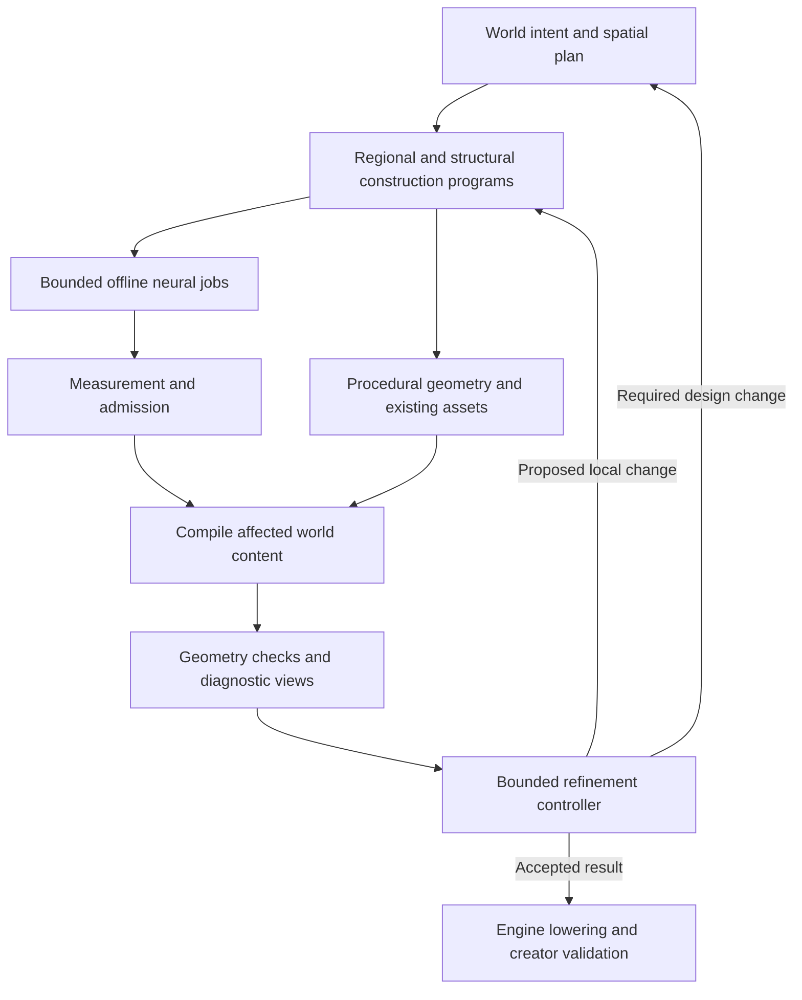

# World Construction and Refinement

Basalt needs a construction workflow that can realize a planned structure through procedural geometry, existing assets, neural generation, or a combination. Catalog search and modular-kit interpretation remain useful, but even flawless versions of those subsystems would not supply that whole workflow. An observation tower missing from the catalog exposes the gap directly.

The recommendation is to make construction programs and their refinement the next integration priority. Preserve the existing world compiler, spatial authority, catalog evidence, and offline generation boundary. Extend the available construction operations and connect them to a controller that observes results, proposes bounded changes, and checks the affected world relationships.

> **Status:** Non-authoritative architecture assessment and proposed integration experiment. The scenario assumes successful implementation of the preceding catalog recommendations. It does not change current contracts, authorize execution, or claim demonstrated 40-square-kilometer generation.

## Scope and assumptions

The target request is a Zelda-inspired open world covering 40 square kilometers, with attractive art direction and deliberate exploration design. The scenario assumes that a capable model can produce valid planning JSON. The relevant question is whether the plan can express the needed operations and whether Basalt can realize, inspect, and revise their consequences. Receiving structured JSON is a normal interface between a model and a compiler; its existence is not evidence against model-driven planning.

The preceding [catalog assessment](catalog-search-assessment.md) addresses discovering objects and interpreting modular parts with sufficient context. The [world-generation survey](world-generation-reuse.md) distinguishes reusable external systems from Basalt-specific responsibilities. This document connects those conclusions through one world request, one missing tower, and one subsequent edit.

Examples below are proposed design choices, not measured optima or existing schema definitions. In particular, the tower dimensions, review scopes, and construction operations illustrate the required behavior. Their implementation and quality still need to be established.

## Current implementation boundary

The statement that Basalt uses only meshes is too broad. Its Roblox lowering already creates native Parts for road spans and procedural stair steps. The stair compiler calculates step bounds from rise, width, tread depth, and maximum riser height; it does not retrieve each step from the catalog. However, this stair path is embedded in a structural assembly workflow, and there is no comparable general construction route for a missing tower.[^1]

| Area | Inspected implementation | Consequence for this scenario |
| --- | --- | --- |
| Primitive geometry | Procedural stair bounds and native road/step Parts exist. | Extend an existing capability into a consistent authoring path. |
| Ordinary realized objects | Instances bind catalog entries, members, assets, and assertions. | The ordinary object path cannot simply emit a new parametric structure. |
| Structural composition | Programs contain slots, lattice placements, interfaces, surfaces, rooms, portals, and stairs. | There is a useful structural representation, but it primarily composes admitted providers. |
| Neural fulfillment | The factory supports reuse, restyling, extension, and synthesis of whole-object alternatives. New assembly semantics require an authored contract. | A missing construction kit cannot currently be repaired by an automatic request for a list of generated parts. |
| Regional proposal | The inspected regional function returns placement-surface centers with constant scores. | This helper is not the complete exploration-design policy; a model may supply richer plans externally. |
| Refinement | World-quality checks are roadmap work; compilation has scoped task records and evidence. | Existing artifacts provide a foundation, but do not constitute the proposed closed feedback loop. |

These observations follow from the current contracts, compiler, connector, factory, and roadmap.[^1][^2][^3][^4] They identify capability boundaries under the assumption of bug-free execution. They do not invalidate the earlier outdoor generation.

## The 40-square-kilometer world request

### Intent and world design

Forty square kilometers is 40,000,000 square meters, or approximately a 6.325-kilometer square if the footprint is square. The plan should record whether that area includes water and inaccessible margins. The working assumption here is total horizontal world footprint; an irregular outline can use the same area. Detailed surface area on slopes is a different measure.

The model should translate the brief into a spatial and experiential design: major landforms, regional identities, route alternatives, landmark relationships, discovery pacing, and a common visual direction. It should record its chosen assumptions about movement. Walking, climbing, and gliding imply different reachable spaces and useful distances. A map cannot acquire those gameplay mechanics merely through geometry or a style label.

Nintendo's primary description of its Breath of the Wild field-design presentation emphasizes intended discoveries, things players should notice or overlook, movement choices, landmarks, vegetation, and density. That supports treating level design as explicit intentions distributed through space.[^5]

For this scenario, interpret the requested triangle method as a design hypothesis about visibility and choice: a landform partly conceals a destination, approaching or climbing it reveals something new, and the player has meaningful ways to continue. This is a proposed operational interpretation, not a reproduction of Nintendo's unpublished implementation. Encoding a triangle label or arranging landmarks into literal triangles would not establish the intended experience.

A useful example is a tower initially visible above a ridge, with its approach concealed. A trail around the ridge reveals a settlement; a climb reveals the tower entrance and a second destination beyond it. The world plan preserves these relationships while terrain and structures are developed. The intended views can be sampled from movement paths and checked against actual geometry. Those checks test visibility and access; human exploration remains necessary to judge whether the sequence is interesting.

### Global construction and regional detail

Generate the complete terrain and major route organization at an appropriate coarse resolution first, including reserved landmark locations and cross-region connections. Establish regional boundaries, elevation transitions, and distant silhouettes before filling every region with detailed objects. Models should operate on summaries and bounded regional plans; deterministic generators expand repeated geometry and population patterns.

Forty square kilometers also requires explicit budgets for loaded geometry, collision, materials, textures, and review work. World extent alone says little about those costs. Streaming, multiple levels of detail, instancing, and regional build artifacts are part of the proposed realization strategy. Their effectiveness on the target engine must be measured; the inspected code does not demonstrate this target scale.

Refining one region must preserve connections to neighboring regions and the distant landmarks visible from it. A local change can invalidate a faraway view, so dependency tracking must follow relationships as well as geographic proximity. Completing one detailed region provides integration evidence; it does not fulfill a request for a finished 40-square-kilometer world.

## Constructing the missing observation tower

### A functional and visual design

The tower request should first establish what must be true of the result: a reachable viewing platform, a visible silhouette from the approach, the views it should reveal, an allowed footprint, and a compatible architectural style. The planner can propose, for example, an 18-meter platform within a roughly 6-by-6-meter footprint, using switchback stairs with landings. These values are illustrative. Player dimensions and movement capabilities determine the necessary clearance and access checks.

From that design, a construction program can describe posts, braces, platforms, openings, stairs, and roof or canopy elements. Repetition and dimensions should be expressed parametrically. The model need not enumerate every vertex or independently request every plank from a neural generator. Geometry tools can calculate transforms and surfaces from a small number of structural choices.

The program should also retain intended style: proportions, silhouette, material palette, surface treatment, and the distribution of detail. A grey blockout verifies only some requirements. The same construction needs a path to finished materials, suitable edges, coherent repeated details, and a convincing appearance from player viewpoints.

### Choosing how to realize each part

| Route | Appropriate use | Tower example |
| --- | --- | --- |
| Reuse measured assets or an understood kit | Existing geometry meets the actual requirement. | Lamps, banners, a roof module, or a compatible stair kit. |
| Procedural construction | Dimensions, repetition, openings, or connectivity determine the form. | Posts, braces, platforms, rails, stairs, and roof profiles. |
| Neural generation | The desired shape or surface treatment benefits from generative modeling. | Sculpted supports, distinctive canopy forms, stonework, ornaments, or materials. |
| Combined construction | Precise usable geometry and expressive generated geometry must coexist. | A checked stair/platform structure combined with generated architectural features. |

These are alternative means of satisfying a construction requirement. They should share units, art direction, placement rules, and downstream checks. A catalog miss should trigger this choice rather than imply that a neural model must generate the entire requested object.

Primitive construction is not restricted to temporary blockouts. Roblox explicitly supports combining basic Parts with custom meshes and applying surface appearance to Parts. Parametric geometry is also an established modeling pattern: Unity ProBuilder can construct stairs by step height or step count and supports different stair forms.[^6][^7]

Basalt should begin with a small reusable operation set: primitive solids, profiles and extrusion, repeated placement, openings, surface attachment, and stair construction. Construction recipes combine those operations. This is more flexible than writing a new hardcoded generator for every object noun, although finite operations still impose limits. A genuinely unsupported shape remains a geometry-capability gap.

Reuse geometry implementations where appropriate. Manifold provides solid-mesh operations, material/property tracking, and maintained JavaScript/TypeScript bindings. It is a candidate for bounded constructive geometry, subject to a direct integration test. It does not supply architectural judgment, level design, or automatic repair of arbitrary neural meshes.[^8]

A construction program must remain declarative data executed by fixed tools. It does not require arbitrary model-authored Blender scripts or code in Roblox import plans. The engine adapter can lower suitable results to native Parts or generated meshes according to measured needs. Preserve the source recipe even if geometry is combined for rendering; rendering granularity and authoring granularity need not be identical.

### Neural generation and the assembly boundary

The proposed strategy does not assume that independent neural requests for posts, stairs, platforms, and a roof will yield a compatible kit. Naming compatible parts in prompts does not enforce matching interfaces, exact dimensions, or coherent materials. Joint part generation and later segmentation can be useful experiments, but the earlier research does not establish them as a reliable way to create extensible, traversable kits.[^9]

For this tower, the most controllable route starts from a shared design and exact usable structure. Neural work receives the relevant design reference and an allowed region. If the task is surface treatment, preserve the geometry where possible. If a generated feature replaces geometry, check the returned feature against the reserved volume, attachment, access, and visual requirements. Reference conditioning alone does not establish conformance.

A complete generated tower can also be acceptable when its actual geometry satisfies the required use. Every landmark need not be decomposed into interchangeable Lego pieces. The appropriate granularity depends on which edits, interactions, reuse, and performance operations are required. A decorative distant tower and a tower the player must climb impose different obligations.

For unusual forms that cannot be expressed well with the available construction operations, whole-object or larger-section generation remains relevant. The current evidence does not support promising arbitrary playable interiors or exact joints from those models. The workflow needs to expose that unresolved capability instead of assuming that segmentation will supply it later.

Avoid an invisible-collision workaround that leaves the visible object functionally misleading. A player should not appear to walk through an ornamental wall or climb stairs that are absent from the render. Collision, visible geometry, and traversal must agree to the tolerance required by the game.

When the tower becomes useful, retain its recipe, admitted component bindings, generated results, and the requirements it satisfies. Later worlds can reuse the construction and vary compatible parameters. Generated components retain the design intent that produced them, while measurement verifies what was actually returned. There is no need to rediscover each component's role from an isolated image.

## One construction state and one refinement controller

The conceptual integration should remain compact. The world plan expresses intent and constraints. Construction programs describe how regions and structures are realized. Their compiled results produce both visuals and measurements. A controller uses those observations to propose changes to the relevant plan or construction parameters.

This diagram is a proposed control flow, not a claim that all of its stages are implemented. The catalog is a reusable source of components and recipes within it. A pending neural job need not stop unrelated terrain, routes, or constructions. A provisional blockout can support continued design while its unresolved appearance remains explicit.

WorldClaw provides a concrete methodological reference. Its terrain refinement re-renders diagnostic views and adjusts terrain, blending, materials, densities, or transforms. Its scene refinement uses a task queue with object and terrain reports, applies targeted corrections, and re-renders until checks pass or an iteration budget is reached. The paper describes Blender-based execution and qualitative world examples; it does not establish the exact navigation, structural, and 40-square-kilometer guarantees required here.[^10]

The public repository inspected for this assessment exposes a README and presentation assets rather than a runnable generation stack. Reuse its demonstrated organization of work as a research pattern; do not describe it as an installed Basalt dependency.[^11]

For Basalt, the controller should observe different scales of the same world:

| Review scope | Evidence | Example intervention |
| --- | --- | --- |
| World | Terrain overview, region graph, routes, distant landmark views, budgets | Relocate a landmark or reshape a ridge while preserving regional connections. |
| Region | Approach-path views, visibility samples, density and style comparisons | Move obstructing vegetation or revise a revealing turn in a path. |
| Structure | Entrances, stair runs, platform views, contact and clearance measurements | Widen a landing, change a canopy, or adjust supports. |

These scopes do not require separate autonomous agents. One controller can invoke the same capable model with the appropriate evidence and tools. The challenge is furnishing relevant observations and bounded actions, rather than multiplying agent roles.

Each proposed change should identify the problem, affected object or region, parameters to change, and constraints to preserve. The compiler applies it against the observed state and recomputes affected results. Geometry checks decide measurable requirements. Visual critique assesses appearance and composition without being treated as proof of hidden geometry or gameplay quality.

For example, a review may find that the tower platform has a poor view. Moving two nearby trees is a possible local correction. Raising the platform changes stairs, supports, silhouette, and distant visibility, so it requires a broader recomputation. Smoothing terrain at the base may improve contact while damaging the entrance slope or a nearby route. The controller needs these dependencies to compare the consequences.

Use bounded iterations, retain accepted states, and reject changes that violate protected constraints. Stop a repair when it passes its checks, reaches its budget, or ceases to improve; retain the unresolved issue instead of endlessly prompting another model. If a design requirement is infeasible, return to the relevant planning decision rather than silently weakening the requirement.

Basalt's current requirement that Blender remain an isolated asset-finishing worker can be preserved. Diagnostic world views should use a lightweight partitioned renderer, with target-engine observations added where needed. This changes the execution tools relative to WorldClaw while retaining the observable edit-and-check workflow. Final Roblox behavior still requires creator-run engine validation.[^4]

## Integration priorities and evidence

The next priority is a completed construction-and-edit path through the system. Catalog enrichment remains useful alongside it. Requiring a perfect corpus before attempting this path would delay evidence about the actual missing capability.

| Priority | Concrete addition | Evidence of success |
| --- | --- | --- |
| General procedural construction | Extend structural programs with bounded geometry operations and consistent materials, surfaces, and collision. | Construct the tower without a tower asset in the catalog. |
| Realization choice | Let a requirement use an existing provider, procedural construction, a generated result, or a combination. | A catalog miss produces a usable construction route when one exists. |
| Shared appearance and geometry constraints | Pass the same design to all contributing routes. | Finished primitives and generated features read as one structure and preserve access. |
| Diagnostic feedback | Supply local renders, measured failures, and an explicit edit surface. | A proposed repair improves the identified problem without breaking protected requirements. |
| World-scale execution | Connect regional artifacts to streaming, detail levels, and resource accounting. | Increasing the completed area stays within measured engine and generation budgets. |

A useful first integrated experiment keeps the full 40-square-kilometer extent at coarse resolution and brings one representative region to finished quality. It includes an observation tower absent from the source catalog, an approach with a visibility reveal, route alternatives, and existing outdoor vegetation. Use procedural structure and at least one bounded neural contribution so the test exercises their integration.

Then request an edit such as raising the tower and widening its access. The edited result should preserve the approach's intended view sequence, usable access, coherent materials, and neighboring world content. Record which geometry and dependencies changed, where neural regeneration was actually necessary, and the cost of reaching an acceptable result. Compare player-height views and traversal with the coarse plan, not only an aerial beauty shot.

This is a proposed experiment, not a completed test or an authorization to run models. After it succeeds, extend finished regions across boundaries and measure full-world performance. The original 40-square-kilometer target remains the completion criterion; the representative region makes the difficult interactions observable before repeating them across the map.

The larger architectural commitment is that world generation includes designing, constructing, observing, and revising usable space. The catalog and neural factory serve that process. Perfect classification of the starting corpus cannot replace it, while a model capable of writing planning JSON can participate directly once the construction and feedback operations are available.

## Sources

Repository observations and public availability were checked September 14, 2026. Recommendations and illustrative designs are distinguished from implemented behavior and externally demonstrated results.

[^1]: Basalt. [Procedural stair compiler](/Users/mawawdi/Desktop/basalt/packages/world-compiler/src/compiler.ts), `createProceduralStairDrafts`; [Roblox world lowering](/Users/mawawdi/Desktop/basalt/packages/roblox/plugin/src/Basalt/WorldLowering.luau), `spanRoad` and procedural stair creation. Steps are generated from metric bounds and lowered as native Parts. This inspection does not constitute a Studio run.

[^2]: Basalt. [World-build contracts](/Users/mawawdi/Desktop/basalt/packages/world-compiler/src/world-build.ts), `REALIZED_INSTANCE_SCHEMA`; [world-planning contracts](/Users/mawawdi/Desktop/basalt/packages/world-planning/src/contracts.ts), `STRUCTURAL_PROGRAM_SCHEMA`; [catalog fulfillment](/Users/mawawdi/Desktop/basalt/packages/asset-factory/src/fulfillment.ts), `CATALOG_FULFILLMENT_OUTCOME_SCHEMA` and `planCatalogFulfillment`. Whole-object synthesis and the explicit requirement for authored assembly semantics.

[^3]: Basalt. [Regional composition](/Users/mawawdi/Desktop/basalt/packages/region-composition/src/index.ts), `composeRegion`; [compilation task records](/Users/mawawdi/Desktop/basalt/packages/world-compiler/src/task-graph.ts). Candidate-site generation and scoped compilation evidence do not establish a complete planning or refinement controller.

[^4]: Basalt. [Architecture](/Users/mawawdi/Desktop/basalt/docs/ARCHITECTURE.md), [roadmap](/Users/mawawdi/Desktop/basalt/docs/ROADMAP.md), [visual contracts](/Users/mawawdi/Desktop/basalt/docs/VISUALS.md), and [engineering rules](/Users/mawawdi/Desktop/basalt/AGENTS.md). Current authority boundaries, planned world-quality verifiers, isolated Blender use, and creator-run Roblox checks.

[^5]: Hidemaro Fujibayashi and Makoto Yonezu, Nintendo. [Field Level Design in The Legend of Zelda: Breath of the Wild — How Hyrule Was Created](https://cedec.cesa.or.jp/2017/session/GD/s59007c6395fd6.html), CEDEC, August 31, 2017; English title translated from the official Japanese session listing. The accessible abstract describes distributed design intentions, movement, landmarks, vegetation, and density. The listing marks presentation materials unavailable; it does not supply a reproducible implementation of the triangle method.

[^6]: Roblox. [3D art and Studio](https://create.roblox.com/docs/art/overview-studio) and [Parts](https://create.roblox.com/docs/parts), current Creator Hub documentation. Primitive construction, surface appearance, and mixed use of basic Parts and custom meshes. This supports the construction pattern, not a Basalt performance claim.

[^7]: Unity. [Stairs](https://docs.unity3d.com/Packages/com.unity.probuilder@6.0/manual/Stair.html), ProBuilder 6.0.9 documentation. Parametric stair forms and generation by step height or count. An authoring baseline, not a recommendation to move Basalt to Unity.

[^8]: Manifold contributors. [Manifold geometry library](https://github.com/elalish/manifold), official implementation and README, current at access. Solid modeling, Boolean operations, material/property tracking, and JavaScript/TypeScript bindings. Integration with Basalt and behavior on its asset inputs remain untested.

[^9]: [Existing world-generation assessment](world-generation-reuse.md), sections on part generation, segmentation, assembly, and exact functional envelopes; primary HoloPart and PartCrafter sources are recorded there. These capabilities do not establish automatic interface-compatible kit production.

[^10]: Chunchao Guo, Jinpeng Li, Yang Li, and Zilong Huang. [WorldClaw: Agentic 3D Open-World Generation at Scale](https://arxiv.org/html/2608.05248v1), August 2026, especially Sections 2.2.3, 2.3.3, and 3. Agentic refinement, diagnostic reports, bounded iteration, and Blender execution. Basalt's proposed navigation and construction checks are additional requirements.

[^11]: Tencent Hunyuan. [Hunyuan3D-WorldClaw](https://github.com/Tencent-Hunyuan/Hunyuan3D-WorldClaw), public repository listing and README, accessed September 14, 2026. Public presentation materials are distinct from a released executable generation pipeline.
