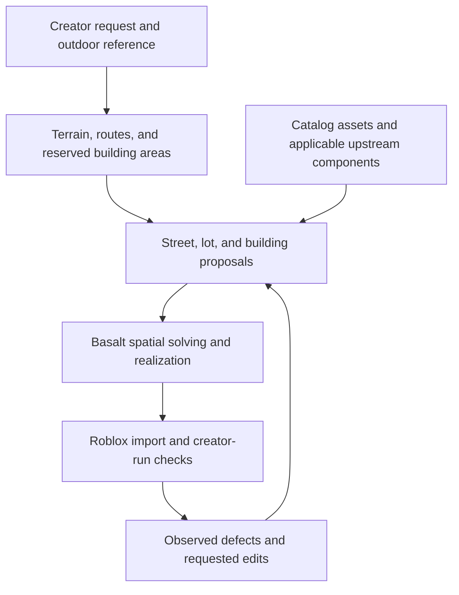

# Basalt and Existing World-Generation Systems

Basalt has already produced an outdoor map: the creator supplied screenshots of terrain, a pond and sandy shoreline, trees, grass, rocks, and smaller vegetation from a generation run predating the current rewrite. The creator reports that the earlier system could not generate a city, and that the starting asset corpus is currently being processed on a GPU cluster under the new architecture. An empty admitted catalog during that work is not evidence that Basalt has never generated a useful world.[^24]

The immediate research question is how to extend that demonstrated outdoor capability into structured settlements, buildings, and connected constructions. Existing systems offer substantial reusable implementations, but their domains matter: Holodeck and SceneSmith demonstrate indoor composition; part models produce or recover components; whole-world generators offer another route to environment appearance and geometry. None of those findings alone establishes an available replacement for Basalt's intended editable city-generation workflow.[^5][^6][^14][^16]

The practical recommendation is to preserve the outdoor result as a regression reference, continue the current catalog work, and test one built-environment extension. Reuse existing implementations at the level where they solve an observed problem. A further taxonomy redesign, replacement of the outdoor generator, or adoption of an entire indoor stack needs evidence from that test.

> **Status:** Non-authoritative foundation assessment. The later catalog-search and
> world-construction assessments supersede its operating recommendations. This document
> does not amend implemented architecture or catalog authority.

The catalog operating account in this assessment is dated September 13, 2026. The
[catalog search and architecture assessment](catalog-search-assessment.md) incorporates
the September 14 selection results and updated account that the holdout and full corpus
have not launched. It provides the newer evaluation and model-selection recommendations.

## Assessment

Six conclusions drive the recommendation.

**The existing outdoor result changes the baseline.** Basalt's progress cannot be assessed solely from an intermediate catalog snapshot or one command in a substantially rewritten codebase. The supplied result is evidence of prior outdoor generation; its reproducibility under the current architecture remains to be checked. Completing the active corpus run is a reasonable input to that work. Catalog completeness creates a risk only if it becomes an open-ended prerequisite to testing representative worlds; the snapshot does not establish that this has happened.[^1][^2][^3][^24]

**The central extension to investigate is structured composition.** A settlement couples routes, lots, building footprints, entrances, and possibly rooms and modular interfaces. Better asset descriptions help find its components; they do not by themselves choose or realize those relationships. This is an architectural hypothesis about the next capability boundary, not a verified explanation of the older system's city-generation failure. Current Basalt contracts already represent several of these relationships.[^1][^2][^24]

**Reuse should match the missing capability.** Holodeck and SceneSmith connect indoor planning, asset selection or creation, placement, and evaluation. Reproducing a relevant upstream example intact can provide a reference for a building or interior adaptation. That is useful without replacing Basalt's demonstrated outdoor capability or assuming an indoor pipeline will plan a city.[^5][^6]

**Whole-first generation followed by decomposition is a credible direction.** HoloPart addresses completion of segmented parts; PartCrafter jointly generates multiple parts; Meta's WorldGen explicitly reconstructs a scene, decomposes it, and enhances individual objects. The unresolved question is the reliability and cost of the particular editing operations Basalt needs. Universal modular-kit recovery is a stronger requirement than obtaining useful separately editable objects.[^14][^16][^17]

**Basalt's useful protections are specific.** Preserving scale, rejecting broken geometry, maintaining a required crossing, preserving an untouched region during an edit, and verifying the imported result can create user value. A semantic identifier or content hash by itself does not demonstrate any of those outcomes. Basalt should measure the improvement produced by each protection rather than treat a more elaborate contract as evidence of a better generator.

**Availability changes the adoption decision.** HoloPart and PartCrafter have released code and MIT-labeled checkpoints. PartField has a noncommercial restriction. Marble has a usable mesh-export API, but its published terms prohibit competitive development and benchmarking. HY-World 2.0 releases a substantial pipeline under territorial restrictions. WorldClaw's inspected public repository contains presentation materials, not executable generation code.[^11][^12][^13][^14][^15][^16][^18]

## Evidence and scope

The assessment targets coherent, editable game-world scaffolds, with Roblox as the first deployment target. It distinguishes four questions: whether a method has demonstrated a capability; whether its implementation is available; whether its artifacts support the required operations; and whether its terms permit the intended use. A paper, an executable repository, and a hosted product provide different evidence.

Public availability and documentation were checked on September 13, 2026. Repository observations describe a working tree undergoing a substantial rewrite, rather than the implementation that produced the supplied outdoor result. The creator dates the screenshots to roughly two days earlier and reports active GPU processing of the corpus. Those statements supply historical and operational context; no GPU job was inspected or changed for this correction.[^24]

The screenshots show a coherent-looking outdoor patch at ground level and from above. Together with the creator's account, they establish a prior generation result worth preserving. They do not expose the original prompt, degree of manual intervention, navigation evidence, repeated-run quality, or the internal algorithm. Numerical results for external systems below are attributed to their authors or providers; no reproduction, paid generation, or Roblox Studio evaluation was performed for this assessment. Adoption rankings are analytical judgments, not measured head-to-head results.

The names HoloPart, PartField, and PartCrafter refer to the official projects linked below. Similar names and unofficial forks should not be used to infer a project's release status. The additional systems were selected because they materially change the build-versus-reuse decision, rather than to produce an exhaustive literature catalog.

## Basalt's current position

Three states must remain distinct: the earlier outdoor generation result; the present rewrite and active catalog processing; and the intended extension to cities and other structured worlds. The first is supported by the creator's account and screenshots, the second by repository inspection and the creator's operational update, and the third remains a capability to demonstrate.[^24]

| Area                       | Evidence at the inspected rewrite snapshot                                                                                                                                            | Bounded implication                                                                                                                                          |
| -------------------------- | ------------------------------------------------------------------------------------------------------------------------------------------------------------------------------------- | ------------------------------------------------------------------------------------------------------------------------------------------------------------ |
| Earlier outdoor generation | Creator-supplied images show terrain, water, shoreline, trees, grass, rocks, and smaller plants; the creator reports a successful generation run.                                     | A prior outdoor result exists. It is a regression reference, not a benchmark of the rewritten implementation.                                                |
| Source corpus              | The catalog records 3,441 source identities with incomplete dispositions and retains measurement and visual-review artifacts; the creator reports the current corpus run is underway. | Corpus preparation is active. Its duration and intermediate status do not establish a faulty architecture or stalled project.                                |
| Runtime catalog            | Zero declarations, assertion bundles, and sealed entries in the inspected catalog commit.                                                                                             | This particular authority root was not ready for catalog-dependent compilation. It says nothing about the earlier catalog or the eventual processing result. |
| World entry point          | The CLI parses a spatial-plan JSON file and passes it to the compiler.                                                                                                                | This command begins at compilation. It does not establish how earlier generation or orchestration outside this command worked.                               |
| Regional composition       | The inspected function proposes the center of each placement surface, with a constant score.                                                                                          | It is a candidate-site primitive, not a demonstrated regional design policy.                                                                                 |
| Neural fulfillment         | Unknown semantic commitments require authority; new synthesis is limited to requests accepting independent whole-object substitution sets.                                            | A provider cannot currently supply an arbitrary structural assembly through this path.                                                                       |
| Corpus scale               | The snapshot schema bounds entries at 65,536 and source identities at 100,000; authoring search decodes matrices and ranks candidate documents locally.                               | Million-asset operation requires a different serving arrangement. Current code should be judged as a local implementation.                                   |

These observations come from the catalog, CLI, composition, factory, and search implementations, not from an inference based on package names.[^1][^2][^4]

The architecture already contains several good separations: descriptive search evidence is distinct from compiler authority; engine-specific behavior is isolated; generated geometry is inspected; and terrain can compile while catalog-dependent stages remain incomplete. Those boundaries can accommodate reused generators. They do not require Basalt to author every generator, retrieval implementation, or geometry algorithm itself.[^1]

The intake question remains relevant, but it is a hypothesis to test against blocked tasks. If a useful candidate must first acquire globally reviewed semantics, substitution membership, complete physical evidence, and an authored assembly grammar, its intake requirements may exceed the immediate product operation. An exact, bespoke landmark placed once does not require the same reusable-interface evidence as a bridge kit that must safely change span. This does not justify interrupting the current catalog run or attributing the historical city limitation to classification.

### From outdoor generation to built environments

The visible outdoor result has substantial variation: terrain elevation, shoreline transitions, tall and low vegetation, rocks, and different viewing scales. It should not be reduced to an assumption that the earlier system merely scattered objects; the images cannot establish its implementation. Natural environments also have spatial, ecological, visual, and gameplay constraints.

The proposed urban extension makes a different set of dependencies central. A street needs a connected route; lots need access to that route; building footprints must respect their lots; entrances must meet usable approaches; and a building assembled from components needs compatible openings, corners, floors, and roofs. If interiors are required, room and vertical circulation must connect to those entrances. Changing a road or widening a building can require several related placements to change together. Classifying each item correctly does not solve this coupled arrangement.

Basalt already represents routes, lot policies, structural programs, rooms, portals, and assembly interfaces. The task is to determine whether the current proposal and realization paths can turn a creator's request into a useful instance of those contracts, with suitable catalog providers. Adding more schema vocabulary alone cannot demonstrate that behavior.[^1][^2]

A discriminating first test is one street and three building footprints on an outdoor patch, using simple known geometry. If the route, access, clearance, and edit requirements fail at that stage, neural mesh detail is not the immediate dependency. If the blockout succeeds but real components fail to realize it, investigate dimensions, interfaces, available kit coverage, and assembly solving. If those succeed but the result misses the requested style, investigate retrieval, visual generation, and critique. These are proposed diagnostic branches, not findings from a city-generation run.

Whole-first generation and decomposition can help supply a building or landmark within this arrangement. They cannot be assumed to repair an inaccessible entrance, disconnected street, or incompatible module simply by splitting a mesh. Conversely, some buildings can remain complete assets if their intended operation only requires placement, appearance, and collision; modularity should follow the requested construction and editing behavior.

## System comparison

“Editable” needs an operation attached to it. Moving an entire environment, selecting a chair, opening a door, extending a bridge, and replacing one region while preserving its neighbors are different capabilities. The table uses the outputs and interfaces documented by each project, rather than assuming all uses of that word are equivalent.

| System           | Available capability                                                                                         | Reuse decision for Basalt                                                                                                                   |
| ---------------- | ------------------------------------------------------------------------------------------------------------ | ------------------------------------------------------------------------------------------------------------------------------------------- |
| **Holodeck**     | Released language-to-indoor-scene pipeline with retrieved objects and relational layout optimization.        | Simpler indoor reference; reuse relevant room and object planning/placement components.                                                     |
| **SceneSmith**   | Released agentic indoor-scene pipeline with generated objects, retrieval, physical processing, and feedback. | Strong indoor integration candidate examined; test a building/interior use case before adopting its stack. City planning is a separate gap. |
| **Marble**       | Hosted world generation, geometry-guided creation, editing, and mesh export.                                 | Technically relevant whole-world provider; competitive-use terms require written clearance.                                                 |
| **HY-World 2.0** | Released panorama, trajectory, expansion, reconstruction, and splat/mesh pipeline.                           | Substantial world-generation alternative; compute and territorial terms affect feasibility.                                                 |
| **HoloPart**     | Completion of already segmented geometry into complete parts.                                                | Candidate offline decomposition/completion worker.                                                                                          |
| **PartField**    | Learned hierarchical segmentation features for 3D shapes.                                                    | Useful technical reference; published license prevents assuming commercial adoption.                                                        |
| **PartCrafter**  | Joint generation of multiple meshes from an image; object and scene checkpoints.                             | Candidate for generating a coordinated object or small assembly as separate parts.                                                          |
| **WorldGen**     | Published layout-conditioned generation and scene-decomposition method.                                      | Particularly relevant architectural evidence; a reusable official pipeline was not located.                                                 |
| **WorldClaw**    | Published large-world method; inspected repository contains README and images.                               | Research reference, not currently a dependency that can be installed and run.                                                               |

Availability and methods are supported by the project sources.[^5][^6][^8][^9][^11][^12][^13][^14][^15][^16][^17][^18] The decisions in the right column are recommendations for this product scope.

### Holodeck

Holodeck demonstrates that language-guided composition with a heterogeneous asset library is already practical within an indoor domain. It asks a language model for spatial relations, retrieves candidate objects, and optimizes placement. It does not require a hand-built universal ontology to understand every stylistic phrase in its input.[^5]

There is real implementation to reuse. Its orchestrator constructs rooms, walls, doors, windows, floor objects, wall objects, and smaller supported objects. The repository recommends its depth-first-search placement route. Its output and runtime are coupled to AI2-THOR, including simulator involvement in small-object placement, so extracting the complete generation behavior is more than translating a final JSON file.[^5][^7]

The useful adaptation boundary is the generated room/object plan and its constraints, followed by Basalt-specific asset resolution, geometry validation, and import. Some upstream stages would need replacement or isolation. The code is Apache-2.0, but that license does not automatically grant rights to every retrieved asset. The inspected main commit is from August 2024, making dependency reproduction a concrete first task rather than something to assume.[^5]

**Recommendation:** retain Holodeck as the simpler reference and possible source of selected planning/placement code. It should be available as a comparison if the more elaborate SceneSmith loop fails to justify its operating cost.

### SceneSmith

SceneSmith offers a substantial existing implementation of indoor composition. Its released pipeline constructs indoor scenes in stages, uses designer/critic/orchestrator interactions, and combines generated static objects with retrieved articulated objects. It retains separate objects and simulator scene descriptions. This supports reuse for buildings and interiors; its published indoor results do not establish street-network, lot, or city-scale planning.[^6]

Its authors report fewer than 2% inter-object collisions and 96% object stability in their evaluation. These are object-level results in their simulation setting, not probabilities that a complete generated game world satisfies every instruction. The reported mean cost is $13.98 and mean elapsed time is 3 hours 26 minutes over 179 rooms, with 25 scenes running concurrently on eight L40S GPUs. That elapsed time is explicitly not optimized single-scene latency; the cost breakdown is dominated by agent calls and does not establish an all-in hosted-service price.[^6]

The source offers concrete reuse opportunities. Room placement implements adjacency-driven search, overlap checks, shared boundaries, and connectivity validation. Asset processing has retrieval/generation entry points and collision processing. These are substantial implementations of problems Basalt is also addressing.[^7]

A wholesale production import has costs: native Drake output, whole-scene Blender rendering, model/data dependencies, and experimental alternative simulator exports. The README recommends at least 45 GB GPU memory for its full documented configuration. Its MIT repository license is separate from the terms of the model and asset sources it uses.[^6][^23]

The paper's failure analysis is also useful: incorrect near-match retrieval, inaccurate material appearance, orientation mistakes, and later-stage placement constrained by earlier decisions. These give Basalt concrete integration tests instead of abstract claims that another system is insufficient.[^6]

**Recommendation:** when a room or interior capability is the next demonstrated blocker, reproduce a small relevant scene using the upstream pipeline, then test its explicit objects and transforms through a bounded adapter. Initially preserve its generation behavior. Extract or replace stages only after measuring a problem; a premature TypeScript rewrite would remove the reference needed to evaluate the rewrite. This experiment need not precede an outdoor settlement blockout, and it is not a recommendation to replace the outdoor generator.

### Marble

Marble must be taken seriously as a world-creation product. Its documented capabilities include input geometry through Chisel, composition and editing workflows, and high-quality textured GLB export. Chisel accepts GLB/FBX reference geometry. These capabilities make it relevant both to whole-world acquisition and to generation conditioned on a Basalt blockout.[^8][^9]

The current API documents an asynchronous mesh-export endpoint. The export documentation describes approximately 600,000-triangle textured meshes and a roughly one-million-triangle vertex-colored alternative, with processing that can take about an hour. It also acknowledges reconstruction artifacts in thin, reflective, transparent, and poorly observed regions. The API does not document a modular assembly contract, persistent per-object editing identities, or a guarantee of exact gameplay dimensions.[^8]

Those missing guarantees are questions for an integration test, not grounds to dismiss the output. A textured mesh can already be useful scenery. If creators mostly need a coherent environment shell plus separately authored interaction points, a whole-world backend could remove a large amount of Basalt-owned generation work.

There is, however, a direct commercial obstacle. Section 2.8(d) of the published terms restricts competitive development and benchmarking, while Section 3.3 permits certain paid/API output uses. The commercial-output permission does not erase the competitive restriction. Given Basalt's stated purpose, Marble should be treated as requiring written clarification or an agreement before integration or a competitive service benchmark. API retention terms also matter to a permanently cached asset library.[^11]

**Recommendation:** treat Marble as a conditional provider opportunity and an important reference for product capabilities. Do not plan an unauthorized benchmark, assume that buying credits resolves the restriction, or infer that a public API means the underlying world model is open source.

### HY-World 2.0

HY-World 2.0 materially strengthens the case for reuse beyond indoor scenes. Its repository includes world-generation inference and model releases, with a pipeline covering panorama generation, navigation trajectories, expansion, and reconstruction. The world-generation module exports splats and a mesh through TSDF fusion; its setup recommends at least four GPUs and reports testing with eight H20 GPUs.[^12]

This is an actual implementation candidate. The exported mesh still needs to be evaluated for object separation, material conversion, gameplay geometry, and target-engine performance. Navigation trajectories used to reconstruct a scene should not be assumed to prove every gameplay route requested by a creator.

Its community license excludes the EU, UK, and South Korea; the inspected text also restricts use and display of outputs outside its defined territory. This is material to an internationally distributed product, not just to the location of an inference server. Separate terms would be needed for uses outside the published grant.[^13]

**Recommendation:** keep it as the principal examined alternative for a complete open-weight world pipeline, conditional on deployment rights and resources. Do not build a worldwide product dependency on an assumption that the code's availability supplies unrestricted output rights.

### HoloPart, PartField, and PartCrafter

These projects address different operations, so they should not be installed as a mandatory three-stage chain.

**HoloPart** takes part segments and generates complete geometry, including previously hidden surfaces. The released instructions explicitly start with a segmented mesh; integration of segmentation into its own pipeline remains a listed future item. Its code and model card identify MIT licensing. Basalt could use it to complete a railing, support, or other component extracted from a generated whole, then measure and finish the result.[^14]

**PartField** produces features that can be clustered into hierarchical parts, including across varied shapes. It does not need a predefined vocabulary of part names. The released repository also documents difficult fragmented-mesh cases. Its NVIDIA license limits use to noncommercial research and education, so it cannot be assumed to be an available commercial worker or a permitted commercial-development benchmark.[^15]

**PartCrafter** jointly generates several meshes from a shared image, so visual planning can happen at the whole-object level while the output retains separate parts. Both object and scene checkpoints are released; its repository and object model card identify MIT licensing. The inspected object CLI caps requested parts at 16. Its inference script also replaces a failed decoded part with a degenerate triangle, which an integration must detect as a failure rather than accept as a usable asset.[^16]

A candidate decomposition route is therefore: obtain an appropriate segmentation, complete hidden geometry when needed, retain the parts' common coordinate frame, finish materials, and test the intended edit. An alternative is joint part generation from the beginning. The resulting pieces can be useful within one assembly even if they are not interchangeable across unrelated assemblies.

Texture handling is a separate integration task. The inspected HoloPart inference path assigns visualization colors to reconstructed parts; PartCrafter exports separate part GLBs and a colored composition. Neither code path, by itself, establishes preservation of the source object's production materials. Geometry, texturing, collision, and module interfaces must be assessed separately.[^14][^16]

**Recommendation:** compare HoloPart and PartCrafter on a handful of actual Basalt editing tasks. Start with an existing or manually supplied segmentation for the HoloPart experiment, so segmentation quality can be distinguished from completion quality. Select an automated segmenter only after checking its implementation and license; HoloPart's recommendation of another repository is not itself a rights grant.

### WorldGen and WorldClaw

WorldGen is unusually relevant to the proposed whole-first approach. Its method starts with a procedural layout and navigation mesh, reconstructs a scene, decomposes it into objects, and enhances them. The paper describes adapting its object decomposition method because the original was too slow and did not generalize adequately to full scenes. It also identifies limitations involving large-world stitching, multiple floors, interior/exterior transitions, and lack of geometry/texture reuse.[^17]

This supports the feasibility of whole-first generation while directly challenging the assumption that object-level decomposition can simply be applied unchanged to arbitrary world meshes. An official reusable end-to-end distribution was not located in the linked publication and official announcement. WorldGen should therefore inform an experiment, not appear in an implementation plan as an already available dependency.[^17]

WorldClaw is already prominent in Basalt's research documentation. Its paper concerns agentic open-world generation, but the inspected public commit contains only `.gitignore`, a README, and two images. It supplies architectural evidence without supplying an executable baseline at that commit. That is a release limitation, not evidence that the authors' demonstrated system does not work.[^18]

## Reuse boundaries

For each observed capability gap, compare the largest useful, legally usable implementation boundary with a smaller component adaptation. The unit might be a complete interior generator, one solver, or an offline part worker. Existing Basalt behavior remains the reference where it already satisfies the task; upstream scope and integration cost determine which boundary is useful.

| Capability                                   | Closest examined baseline                                                                                                    | Basalt-owned remainder                                                                                                                                    |
| -------------------------------------------- | ---------------------------------------------------------------------------------------------------------------------------- | --------------------------------------------------------------------------------------------------------------------------------------------------------- |
| Indoor scene planning and refinement         | SceneSmith; Holodeck as a simpler comparison                                                                                 | Preserve creator constraints, translate proposals, and support the target editing workflow.                                                               |
| Connected streets, lots, and building access | Basalt already represents routes, lots, and structures; the examined indoor systems do not establish a complete city planner | Test a small urban block and identify the missing proposal or solving step. This report does not establish the best reusable urban-layout implementation. |
| Whole-world appearance and reconstruction    | HY-World 2.0; Marble with appropriate permission                                                                             | Target-engine conversion, selected object recovery, gameplay integration, and bounded regional edits.                                                     |
| Part completion or joint generation          | HoloPart; PartCrafter                                                                                                        | Input preparation, coordinate preservation, material finishing, defect detection, and the requested edit.                                                 |
| Descriptive asset search                     | NVIDIA USD Search's caption/embedding/hybrid-search implementation                                                           | Bind retrieved identities to Basalt's measured facts and local requirements.                                                                              |
| Navigation analysis                          | Recast/Detour                                                                                                                | Configure the agent envelope, identify required destinations, and compare with target-engine behavior.                                                    |
| Procedural asset production                  | Infinigen's procedural generators                                                                                            | Select useful generators, control dimensions/style, finish assets, and measure outputs.                                                                   |
| Engine import and repair accountability      | Existing Basalt adapter and artifact boundaries                                                                              | Exact imported state, creator edits, dependency tracking, and targeted repair.                                                                            |

USD Search combines generated descriptive metadata with visual/textual and keyword retrieval. Its deployment architecture also demonstrates established indexing services rather than a requirement to invent a new global classifier. Recast supplies navigation-mesh construction and pathfinding; Infinigen supplies procedural generation implementations. These are reuse candidates, not evidence that installing their entire stacks is appropriate for a 3,441-asset prototype.[^19][^20][^21]

For search specifically, Basalt's present direction is already aligned with the external baseline. Replacing a small working local index immediately with a cloud service could add unnecessary work. Preserve a separable search interface and move to established indexing when measured load requires it. The difficult Basalt question remains whether a retrieved candidate satisfies the current world requirement. The active metadata run is consistent with building that capability; its existence is not evidence of misplaced effort.

### A bounded integration path

The following is a proposed experiment extending the outdoor reference, not a new canonical schema. Existing Basalt paths and reused components can supply proposals; the experiment determines where each is useful:

The candidate needs a small amount of useful data: asset references, transforms with declared units, parent/group relationships, intended functions, original descriptive requests, and available evidence. Basalt then checks the claims needed for this scene. Retain upstream identifiers as provenance; give accepted content stable Basalt identities. Do not expose upstream model-authored scripts as executable Roblox import instructions.

If the experiment calls for a SceneSmith adapter, begin with a room containing static objects and use its structured scene state and mesh references. Map units, coordinate frames, object transforms, and materials explicitly. Check that the adapter preserves the upstream arrangement before changing placement policy. Articulated objects should be included only when their joints have a supported target representation; silently freezing a requested working drawer would change the task.

For a whole-mesh backend, begin by treating the output as a scene candidate. Determine whether the required operations actually demand object extraction. A distant cliff might need only efficient rendering and a collision boundary; a door needs a separable opening mechanism if the experience requires it. Apply decomposition where it enables a specified operation, rather than to every triangle in every scene.

Roblox conversion is tangible engineering work. Its current general modeling documentation specifies a 20,000-triangle limit for an individual mesh. A large environment export may require partitioning or simplification, material preparation, collision handling, and upload/import checks. Partitioning for that budget is distinct from discovering semantic objects, and neither operation establishes a reusable construction kit.[^22]

### Existing architectural restrictions

Some current rules need an explicit design decision if a full upstream generator is adopted. SceneSmith's whole-scene Blender rendering conflicts with Basalt's restriction against requiring Blender to render or review complete worlds. Reusing that production loop intact would require changing the rule; retaining the rule requires a rendering adaptation and a check that the critic still receives adequate evidence. That cost should be visible in the comparison.[^1][^6]

Likewise, generating a new asset can remain outside deterministic compilation while still being part of the current creation job. Basalt can produce terrain and a provisional layout while asset generation proceeds, then bind accepted results. A nonblocking foundation does not imply that a complete cold generation has no wait. This distinction preserves reproducibility without ruling out generation-led scene workflows.

External numeric solvers also need not be rewritten merely because Basalt records deterministic artifacts. First determine whether a solver can run with controlled inputs and settings, and whether its accepted output can be captured as an immutable result. Cross-platform bitwise recomputation is a separate requirement that should be justified where it is needed. An artifact hash is not a reason to develop a replacement for every established geometry library.

## Large assets and modularity

A bridge provides a useful example because it has both appearance and function. Its required crossing, usable width, endpoints, and collision envelope can be established before final detail. The visual result can then be obtained through existing components, procedural geometry, joint part generation, or completion of a generated whole. Each route should be judged on the same final crossing and edit requirements.

**Building the whole concept first does not require emitting one fused mesh.** A shared blockout, image, or scene specification can guide several related parts. PartCrafter provides one concrete mechanism for joint output. Conversely, a fused result can be useful if a later decomposition stage recovers the pieces required for editing. These approaches can coexist without imposing a single construction strategy on all assets.[^16]

The relevant requirements should be tested separately:

| Requested capability              | What must actually be demonstrated                                                                             |
| --------------------------------- | -------------------------------------------------------------------------------------------------------------- |
| Render a large bridge efficiently | Acceptable mesh/material budgets and appearance at intended viewing distances.                                 |
| Move its railing                  | A coherent separate component with usable geometry and material treatment.                                     |
| Extend the span                   | A reconstruction or assembly method that preserves width, endpoints, supports, and appearance after extension. |
| Reuse a railing in another bridge | Compatible dimensions and interfaces in the new context.                                                       |
| Let two players pass              | Clear usable width for the configured player collision shapes, including obstructions and approaches.          |

Success on the second row does not establish success on the fourth. However, failure to achieve universal reuse should not disqualify a landmark that satisfies its intended editing and gameplay requirements. Basalt needs a way to retain a bespoke assembly as such without pretending its components form a general construction grammar.

The reverse error also matters. Visually clean segmentation cannot repair an incorrectly placed crossing by itself. If the original scene is functionally wrong, splitting its mesh preserves that error. When exact dimensions matter, geometry after neural reconstruction must be checked against the required envelope; merely conditioning generation on a correct blockout is insufficient evidence.

This suggests a practical division: establish the geometry that governs play; generate or retrieve the appearance and less constrained detail; preserve editable groups; and validate the final composition. The division can operate at the level of a whole room, a bridge, or a small component. It does not require top-down decomposition into individual bricks for every structure.

## Taxonomy, evidence, and the starting corpus

The taxonomy question becomes easier when three different tasks are kept explicit: describing an asset for discovery, deciding whether it works in a particular location, and establishing that it can substitute for another asset across an authored range of uses. They do not need the same completeness or authority.

A description such as “weathered stone bridge with carved animal reliefs” should remain available throughout generation and review. The compiler may need to reason about a crossing, a walking surface, dimensions, and collision. It does not necessarily need a new globally reviewed concept for every combination of animal motif, material treatment, and architectural style. Dropping those descriptive clauses because only “bridge” has a formal concept would weaken instruction following.

For truly new behavior, the situation is different. If a request describes a bridge that retracts or teleports its occupants, a descriptive tag does not implement the mechanism. That requirement needs an actual supported realization, a scoped approximation accepted by the creator, or an explicit incomplete result. Open vocabulary is compatible with honest capability limits.

**Recommendation:** keep formal semantics focused on distinctions the compiler actually consumes, while preserving open descriptive intent and its evaluation evidence. If adopting this requires changing the current rule that a novel noun must become a reviewed leaf before its intended use, make that change explicitly. Do not hide the change by relabeling uncertain metadata as admitted truth. This is a proposed adjustment to authority scope, not a claim that the current contracts already support every such use.[^1][^4]

### Baseline quality

Basalt already has a prior outdoor generation result. The 3,441 assets do not all need complete, perfect semantic treatment to preserve that result or test a bounded extension. The current corpus run can provide useful coverage and evidence under the rewritten architecture; there is no reason in the supplied evidence to stop it. Its results should be evaluated against actual scene requirements rather than equating processing completion with universal catalog correctness.

The initial set needs enough coverage to attempt representative worlds and enough trustworthy evidence for the operations those worlds use. A small reference set should be carefully checked; the rest can remain searchable, pending, or unusable without blocking unrelated work. Completing automated metadata generation is different from requiring exhaustive human semantic approval of every asset before a city blockout can be tested.

The existing corpus is still valuable. It tests unit handling, source quality, material variation, ambiguous descriptions, structural components, and retrieval distractors. It also provides immediate reusable content. Its value is greatest when those variations reveal failures in actual scenes, rather than becoming reasons to expand a universal taxonomy in advance.

Starting with no bespoke asset library is technically possible when an upstream generator supplies the content. It does not remove pretrained priors, material libraries, inference infrastructure, or the need to verify generated geometry. Generation-led and retrieval-led routes should be compared on the final task. There is no evidence here that dropping the existing corpus would automatically improve quality or total cost.

### Million-asset consistency

Consistency at that scale should mean stable content identity, declared units and frames, traceable measurements, searchable descriptions, and requirement-specific acceptance. It need not mean that every asset has been exhaustively assigned to a perfect global hierarchy. A candidate's suitability can be assessed when it is actually retrieved for a scene; reusable interfaces require stronger evidence only when reuse relies on them.

The planner's request is useful provenance, but the generator's output is still a separate object of verification. Asking for a hollow arch does not prove that the produced geometry has a traversable opening. Caching the accepted result can avoid repeating work, but only for sufficiently similar future requirements. Diversity in shape, dimensions, materials, style, and function makes a fixed “first 1,000 worlds complete the cache” assumption unjustified.

The first scale decision should therefore concern search and storage interfaces. Basalt's current local limits are not evidence that the product cannot grow; they are evidence that production serving is unfinished. Expansion should follow measured query load and working representative scenes under the current architecture.[^4][^19]

## Cost and delivery evidence

Published numbers are useful for planning an experiment, but they are not directly comparable performance scores.

| System                                              | Published operating information                                                 | Appropriate interpretation                                                                                                    |
| --------------------------------------------------- | ------------------------------------------------------------------------------- | ----------------------------------------------------------------------------------------------------------------------------- |
| Marble standard text generation plus HQ mesh export | 1,580 + 3,500 credits; at 1,250 credits per dollar, $4.064 per new result.      | Calculated API charges before retries, adaptation, and other infrastructure. Relevant only if the intended use is authorized. |
| Marble HQ mesh processing                           | Documentation says processing can take about an hour.                           | A usable world preview and a finished mesh export have different delivery times.                                              |
| SceneSmith                                          | Mean reported cost $13.98; mean elapsed time 3:26 in its concurrent evaluation. | A research operating point, not a quote for single-scene production service.                                                  |
| HY-World 2.0                                        | World-generation setup recommends at least four GPUs.                           | A resource requirement to investigate; no comparable all-in per-world cost was established here.                              |

The prices and timings are provider/author figures, and the Marble total is arithmetic from its published tariff.[^8][^10][^6][^12] They should not be plotted as if they measured the same scene, quality, or hardware budget.

For Basalt, the useful metric is cost and creator effort per accepted result. That includes failed attempts, asset acquisition, verification, repair, import, and requested changes. A cheap whole-mesh generation can become expensive if substantial manual reconstruction follows. A more expensive structured scene can be worthwhile if it saves that work. The experiment must retain both kinds of cost.

## Proposed decision experiment

The next milestone should preserve the known outdoor capability and expose the first missing built-environment operation. This is a proposed experiment after the relevant current catalog outputs become available, not an instruction to interrupt that run or undo the rewrite. Simple blockout planning can be evaluated independently of detailed asset availability. Paid execution and Studio checks are future steps; they have not been performed as part of this report.

### 1. Preserve the outdoor reference under the current architecture

Use the earlier prompt, accepted scene artifacts, and camera views where available. Otherwise define a comparable outdoor task containing the visible terrain, water, shoreline, and vegetation features, and label the comparison accordingly. Preserve the expected behavior through the current contracts; this does not call for restoring obsolete schemas or maintaining a second architecture.

The deliverable is a recorded current-architecture outdoor result and a clear account of any regression. Distinguish replaying accepted artifacts from generating a new result. Record remaining catalog bindings as such, rather than interpreting them as planning failures. The creator runs Studio checks and reports the observed result, consistent with the repository's engine-evidence boundary.

### 2. Extend the outdoor patch with one street and three buildings

Start with simple known geometry and explicit requirements: a connected street, three nonoverlapping building footprints, a usable approach to every requested entrance, and a protected pond or forest area. Define player clearance and slope limits before the test. Require one edit, such as widening the street while preserving the pond and maintaining access to each building.

Then bind real catalog assets or one suitable kit to the accepted layout. Start with the smallest construction strategy that satisfies the task: complete buildings can test placement and access; a modular facade, room, or bridge can test assembly and dimensional changes. Do not require a complete city grammar or decomposition of every building into bricks for this first extension.

Compare the plan, realized geometry, and imported result. A good plan that cannot be filled points toward provider coverage or assembly realization. A good realized scene damaged by import points toward conversion. A disconnected blockout points toward layout proposal or solving. These observations are more actionable than the aggregate statement that city generation failed.

### 3. Compare relevant upstream capabilities on a varied task set

Choose an upstream comparison for the observed blocker. A room-layout or furnishing failure justifies a Holodeck or SceneSmith example. A part-editing failure justifies HoloPart or PartCrafter. A street/lot planning failure requires a dedicated urban-layout implementation search; the indoor and part results in this report do not settle that selection. Reproduce the selected upstream behavior before rewriting it, and check the rights of the actual model and asset dependencies.

For an indoor adapter, preserve explicit object boundaries, units, transforms, grouping, and materials. Evaluate upstream output before conversion and after import to isolate conversion loss. A documented upstream example is a component reference; it should not displace the outdoor regression test or be presented as evidence of city generation.

Expand the settlement pilot to six tasks: two outdoor regression cases, two settlement layouts, one requested structural edit, and one unfamiliar style or descriptive combination. Keep four for development and two untouched until the decision run. Test at least two recorded generation attempts per task within a fixed budget. Unsupported domains must be labeled as scope gaps, not quietly rewritten into easier prompts.

Each task should have a plain-language acceptance sheet written before generation: required objects and counts, required connections, negative constraints, visual references where appropriate, and the exact edit to attempt afterward. Include near-confusers and a genuinely novel descriptive combination. The set is a diagnostic pilot, not evidence of arbitrary-prompt reliability or a statistical guarantee over future worlds.

For the bridge/decomposition comparison, use a stone bridge, a timber crossing, a gatehouse, and an organic landmark. Compare an existing or procedural assembly, whole generation plus completion of supplied segments, and joint part generation where appropriate. Score the completed editing task, not just segmentation overlap. If a backend is unsuitable for one case, record the limitation explicitly.

### 4. Measure product operations

| Dimension             | Evidence to retain                                                                                                          |
| --------------------- | --------------------------------------------------------------------------------------------------------------------------- |
| Instruction following | Fulfillment of each required clause, including counts, relations, exclusions, and distinctive appearance.                   |
| Spatial function      | Crossing continuity, usable openings, reachable destinations, support, and configured player clearance.                     |
| Visual quality        | Blind comparison at multiple viewpoints and gameplay distances; inspect the actual imported materials.                      |
| Editability           | Move/remove a selected object, widen or extend a structure, and regenerate one region while checking protected neighbors.   |
| Efficiency            | Wall time, model charges, GPU use, failed attempts, manual repair time, mesh/material counts, and target-device behavior.   |
| Reproducibility       | Whether accepted artifacts can be replayed and imported again; distinguish this from resampling a model with the same seed. |

Compare current Basalt behavior with the outdoor reference and score the added settlement operations separately. Where an upstream component is tested, evaluate its result before adaptation, after adaptation, and after any Basalt-specific repair. Use the same requirements and review standard for each route. Do not compare an external demonstration against an untested Basalt claim, or judge a polished upstream render against an untextured local blockout.

Whole-world service comparisons are conditional on applicable permission. If Marble clearance is unavailable, omit service access from the experiment and retain only the public-documentation assessment. HY-World execution similarly depends on rights and suitable resources. Those exclusions do not prevent a structured-generator or part-generation experiment.

### 5. Make an explicit implementation choice

The experiment should end in a scoped decision about the first missing operation:

1. **Connect existing Basalt capabilities** if the represented plans and current solvers can satisfy the task once catalog providers and orchestration are connected. Avoid adding another architecture to repair an integration gap.
2. **Adapt a proven upstream implementation** if it satisfies the missing operation within acceptable integration cost. The reusable unit may be a complete interior loop or an individual solver; retain only the additional Basalt controls that improve the measured result.
3. **Build a narrowly defined missing capability** if a relevant implementation search and bounded adaptation fail to meet a central requirement. State the failed requirement and evidence before expanding contracts. Lack of a city demonstration from an indoor system is not evidence that no useful urban-layout implementation exists.

If the bottleneck is rejection by an unnecessarily broad intake contract, review that contract. If the bottleneck is malformed geometry, improve finishing or change the generator. If the bottleneck is coherent regional layout, work on the planning loop. These diagnoses imply different actions; labeling all of them “asset classification” conceals the decision.

## Recommended priorities

**Preserve the outdoor result and continue the active catalog work.** The earlier generation supplies a concrete behavior to retain through the rewrite. The current corpus run supplies potential content and evidence; an empty intermediate catalog is not a reason to abandon it. Verify the relevant outputs against a small set of scene requirements when they become available.

**Make one connected built-environment extension the next capability test.** A street with three buildings, usable entrances, and a protected natural area can expose whether the first gap is planning, provider coverage, assembly, or import. The existing route, lot, room, portal, and interface contracts should be exercised before adding another taxonomy or universal construction framework.

**Reuse implementations for the gap the test reveals.** Holodeck and SceneSmith are candidates for indoor composition and feedback. They are not established substitutes for Basalt's outdoor generator or a complete city planner. Preserve an applicable upstream loop long enough to measure what its adaptation retains.

**Use HoloPart and PartCrafter as candidate workers for specific editing needs.** Their outputs are useful enough to test directly. Basalt should own the evidence that a generated part works in its intended role, rather than develop an equivalent part model or require every output to become a universal module.

**Preserve existing measurement, immutable artifacts, and engine boundaries where they support the experiment.** Also preserve the distinction between a plausible proposal and a verified claim. Imported-state verification should not be described as proof of overall visual quality or prompt fidelity.

**Keep corpus perfection separate from the next generation milestone.** Automated processing of all starting assets can be worthwhile. Universal semantic certainty, every possible assembly grammar, and million-asset serving are different requirements and should not all gate a bounded settlement test.

**Treat differentiation as a measurable hypothesis.** A useful Basalt advantage could be coherent gameplay geometry, dependable local edits, efficient asset reuse, and faithful Roblox realization. The present evidence establishes a prior outdoor result and substantial reusable external capabilities; it does not establish comparative superiority or the current architecture's city-generation ability. The next decision should come from extending that result, with each new mechanism tied to an observed limitation.

## Sources

The numbered notes below provide the source inventory. Public documents were accessed September 13, 2026. Repository snapshots identify the inspected source state; hosted product documentation and terms can change. Local paths refer to the inspected Basalt working tree.

[^1]: Basalt. [Product thesis and invariants](/Users/mawawdi/Desktop/basalt/docs/BASALT.md); [implemented architecture](/Users/mawawdi/Desktop/basalt/docs/ARCHITECTURE.md); [catalog authority root](/Users/mawawdi/Desktop/basalt/registry/catalog.json). Working-tree inspection. The catalog's embedded commit hash was `16e13a50f682efef671e089b157efd89da7da8c0c81343df67f90bfeb618b693`; counts in this report refer to that root.

[^2]: Basalt. [CLI implementation](/Users/mawawdi/Desktop/basalt/packages/cli/src/index.ts), `worldCompile`, lines 583–615; [regional composition](/Users/mawawdi/Desktop/basalt/packages/region-composition/src/index.ts), `composeRegion`; [planning contracts](/Users/mawawdi/Desktop/basalt/packages/world-planning/src/contracts.ts), `SpatialWorldPlan` and `IntentInterpretationTrace`. Working-tree inspection. The CLI file's SHA-256 was `32fcf1cf5e48fd9e9e498d69586f7cabf9d1a4407e40a1d02ad54f2bdff8844a`.

[^3]: Basalt. [Task board](/Users/mawawdi/Desktop/basalt/TASKS.md), current actionable work and acceptance gates. The task board supersedes the deleted planning document cited by the original assessment.

[^4]: Basalt. [Factory fulfillment](/Users/mawawdi/Desktop/basalt/packages/asset-factory/src/fulfillment.ts), semantic/evidence gaps and `authored_entry_contract_required`; [authoring search](/Users/mawawdi/Desktop/basalt/packages/catalog-authoring/src/search.ts), `executeCatalogSearch`; [catalog entry contracts](/Users/mawawdi/Desktop/basalt/packages/catalog-model/src/entries.ts), `CATALOG_SNAPSHOT_SCHEMA`; [semantic kernel](/Users/mawawdi/Desktop/basalt/packages/semantic-kernel/src/index.ts). Working-tree inspection.

[^5]: Yue Yang et al. [Holodeck: Language Guided Generation of 3D Embodied AI Environments](https://arxiv.org/abs/2312.09067), CVPR 2024, revised April 22, 2024. Allen Institute for AI, [official repository and setup](https://github.com/allenai/Holodeck/tree/362b8ed948b867b69a72f1f9491f4caa88419bfc) and [Apache-2.0 license](https://github.com/allenai/Holodeck/blob/362b8ed948b867b69a72f1f9491f4caa88419bfc/LICENSE). Inspected main commit dated August 26, 2024.

[^6]: Nicholas Pfaff, Thomas Cohn, Sergey Zakharov, Rick Cory, and Russ Tedrake. [SceneSmith: Agentic Generation of Simulation-Ready Indoor Scenes](https://arxiv.org/html/2602.09153v2), revised May 30, 2026, particularly Appendix O.5, Tables 18–19, and Appendix S. [Official implementation and setup](https://github.com/nepfaff/scenesmith/tree/67cc408fd38334b4a926efef45e284302ed5055b), especially Scene Generation, Visualization, and Export; [MIT license](https://github.com/nepfaff/scenesmith/blob/67cc408fd38334b4a926efef45e284302ed5055b/LICENSE). Repository commit dated May 20, 2026; the later paper revision and the code snapshot are distinct artifacts.

[^7]: Allen Institute for AI. [Holodeck generation orchestrator](https://github.com/allenai/Holodeck/blob/362b8ed948b867b69a72f1f9491f4caa88419bfc/ai2holodeck/generation/holodeck.py), `generate_scene` and `generate_small_objects`. Nicholas Pfaff et al. [SceneSmith room placement](https://github.com/nepfaff/scenesmith/blob/67cc408fd38334b4a926efef45e284302ed5055b/scenesmith/floor_plan_agents/tools/room_placement.py) and [asset manager](https://github.com/nepfaff/scenesmith/blob/67cc408fd38334b4a926efef45e284302ed5055b/scenesmith/agent_utils/asset_manager.py). Direct source inspection.

[^8]: World Labs. [Mesh export](https://docs.worldlabs.ai/marble/export/mesh), including mesh variants, processing time, and reconstruction limitations; [Export a world API](https://docs.worldlabs.ai/api/reference/worlds/export); [Get a world API](https://docs.worldlabs.ai/api/reference/worlds/get). Current public documentation.

[^9]: World Labs. [Chisel basics](https://docs.worldlabs.ai/marble/create/chisel-tools/chisel-basics), geometry input and blockout guidance; [Marble overview](https://docs.worldlabs.ai/), creation, editing, and composition workflows. Current public documentation.

[^10]: World Labs. [World API pricing](https://docs.worldlabs.ai/api/pricing), credit conversion, standard world-generation totals, and HQ mesh export. The reported $4.064 is `(1,580 + 3,500) / 1,250`; it excludes retries and non-API work and is not the tariff for every model configuration.

[^11]: World Labs. [Terms of Service](https://docs.worldlabs.ai/terms-of-service), Sections 2.8(d), 2.10, and 3.3. The recommendation concerns Basalt's proposed competitive-product use; it does not assert that all third-party commercial integrations are prohibited.

[^12]: Team HY-World. [HY-World 2.0 official repository](https://github.com/Tencent-Hunyuan/HY-World-2.0/tree/df9988efb87bfc0f4947eb3889411cf957478b06) and [World Generation Module](https://github.com/Tencent-Hunyuan/HY-World-2.0/blob/df9988efb87bfc0f4947eb3889411cf957478b06/hyworld2/worldgen/README.md), release entries, pipeline scripts, prerequisites, and mesh export. Inspected main commit dated August 12, 2026. [Technical report](https://arxiv.org/abs/2604.14268), April 2026.

[^13]: Tencent. [HY-World 2.0 Community License](https://github.com/Tencent-Hunyuan/HY-World-2.0/blob/df9988efb87bfc0f4947eb3889411cf957478b06/License.txt), release date April 15, 2026, especially the Territory definition and Section 5(c).

[^14]: Yunhan Yang et al. [HoloPart: Generative 3D Part Amodal Segmentation](https://arxiv.org/abs/2504.07943), April 10, 2025. VAST-AI Research, [official implementation](https://github.com/VAST-AI-Research/HoloPart/tree/48dd632c9a7412e6688573bb4f153e0ade7e7325), [inference script](https://github.com/VAST-AI-Research/HoloPart/blob/48dd632c9a7412e6688573bb4f153e0ade7e7325/scripts/inference_holopart.py), [MIT license](https://github.com/VAST-AI-Research/HoloPart/blob/48dd632c9a7412e6688573bb4f153e0ade7e7325/LICENSE), and [model card](https://huggingface.co/VAST-AI/HoloPart). Inspected repository commit dated April 11, 2025.

[^15]: Minghua Liu et al. [PartField: Learning 3D Feature Fields for Part Segmentation and Beyond](https://arxiv.org/abs/2504.11451), April 15, 2025. NVIDIA Toronto AI Lab, [implementation and documented failure cases](https://github.com/nv-tlabs/PartField/tree/373025dbd283bb44cc4a6dc78c99994dbc91de32); [license, Section 3.3](https://github.com/nv-tlabs/PartField/blob/373025dbd283bb44cc4a6dc78c99994dbc91de32/LICENSE). Inspected main commit dated June 2, 2026.

[^16]: Yuchen Lin et al. [PartCrafter: Structured 3D Mesh Generation via Compositional Latent Diffusion Transformers](https://arxiv.org/abs/2506.05573), June 2025, NeurIPS 2025. [Official repository](https://github.com/wgsxm/PartCrafter/tree/3d773bf02fad51c7ab31a5615573fec93b287b30); [object inference script](https://github.com/wgsxm/PartCrafter/blob/3d773bf02fad51c7ab31a5615573fec93b287b30/scripts/inference_partcrafter.py), including `MAX_NUM_PARTS`, failed-part handling, and exports; [MIT license](https://github.com/wgsxm/PartCrafter/blob/3d773bf02fad51c7ab31a5615573fec93b287b30/LICENSE); [object model card](https://huggingface.co/wgsxm/PartCrafter). Inspected main commit dated April 16, 2026. Transitive model/data dependencies require their own terms review.

[^17]: Dilin Wang et al., Reality Labs, Meta. [WorldGen: From Text to Traversable and Interactive 3D Worlds](https://arxiv.org/html/2511.16825v1), November 2025 technical report, particularly Sections 3–5 and 9. Meta, [official research announcement](https://www.meta.com/blog/worldgen-3d-world-generation-reality-labs-generative-ai-research/). Availability finding is limited to the inspected official publication and linked release surfaces; unrelated repositories with the same name are not treated as this implementation.

[^18]: Chunchao Guo, Jinpeng Li, Yang Li, and Zilong Huang. [WorldClaw: Agentic 3D Open-World Generation at Scale](https://arxiv.org/abs/2608.05248), August 5, 2026. Tencent Hunyuan, [public repository at inspected commit](https://github.com/Tencent-Hunyuan/Hunyuan3D-WorldClaw/tree/427e5f953bbc2eedccbf82415cc597387d47e5d9), dated August 13, 2026. The recursive tree contains `.gitignore`, `README.md`, `assets/pipeline.jpg`, and `assets/teaser.jpg`.

[^19]: NVIDIA. [USD Search repository](https://github.com/NVIDIA-Omniverse/usd-search/tree/cfd1268b49b2f8a647bdf3942f3034c9d4b726e6), inspected main commit dated July 8, 2026; [Omniverse Services USD Search architecture](https://docs.omniverse.nvidia.com/services/latest/services/usd-search/architecture.html). Repository and service documentation describe related implementations; their exact model/configuration choices should not be assumed identical.

[^20]: Recast Navigation contributors. [Recast Navigation / Detour](https://github.com/recastnavigation/recastnavigation), official repository and module descriptions. Current public implementation of navigation-mesh construction and navigation queries.

[^21]: Princeton Vision and Learning Lab. [Infinigen](https://github.com/princeton-vl/infinigen), official repository, procedural environment/asset generation and licensing documentation. Reuse recommendation concerns selected generators; it is not a proposal to require its whole-scene pipeline inside Basalt.

[^22]: Roblox. [General modeling specifications](https://create.roblox.com/docs/art/modeling/specifications), Geometry and Textures. Current documentation states the per-mesh triangle limit; a final import and target-device check is still required.

[^23]: Meta. [SAM 3D Objects license](https://github.com/facebookresearch/sam-3d-objects/blob/main/LICENSE), SAM License, updated November 19, 2025. SceneSmith's selected generation backend and retrieved datasets are distinct dependencies from its MIT orchestration code; this report does not certify every optional dependency or dataset for commercial redistribution.

[^24]: Basalt creator. Account and two screenshots supplied in this conversation on September 13, 2026. The creator reports an outdoor generation run roughly two days earlier, a substantially changed codebase since that run, inability of the earlier implementation to generate a city, and a currently running GPU corpus-processing job. The screenshots show the same outdoor scene from ground level and above: `codex-clipboard-aa522288-39eb-43b2-bce9-5e81424f6db8.png` and `codex-clipboard-5b2bb329-2fa8-4006-b323-8582ef78f7bb.png`. These are conversation attachments, not repository artifacts; no original prompt, run log, or engine verification receipt was supplied with them.
